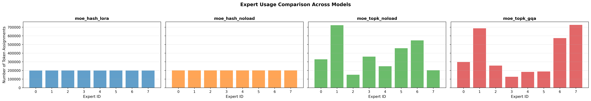

# Sparse mixture-of-experts for text summarization

A PyTorch implementation of a sparse mixture-of-experts (MoE) Transformer for extreme summarization: turning a news article into a short, single-sentence summary. This project compares a model trained from scratch on XSum with an existing BART summarizer, fine-tuned T5-base, and instruction-tuned Llama-3.2-1B.

I built the expert networks, token routers, sparse dispatch layer, and encoder-decoder model, then evaluated how routing, load-balancing settings, grouped query attention, and low-rank expert layers affected the outputs. The work began as Assignment 3 for Advanced NLP (M25) at IIIT Hyderabad.

The pretrained models produced substantially better summaries than the MoE models trained from scratch. The experiments document that gap through automatic metrics, expert-usage plots, and manual review.

[Experiment report](report.pdf) | [Human evaluation samples](human_eval.json) | [Saved predictions](https://drive.google.com/drive/folders/1ATrIohDP1F6RANQYpu9uD_iOO0xbIjz1?usp=sharing)

## What I implemented

- A sparse MoE decoder with eight feed-forward experts per layer. A learned top-k router selects two experts per token; a projection-based hash router selects one.
- An encoder-decoder Transformer with four encoder and four decoder layers, a hidden size of 512, eight attention heads, and a feed-forward width of 2,048.
- A configurable expert-usage penalty and experiments with its weight set to 0.01 or zero.
- Custom grouped query attention (GQA), including key/value caching, and expert layers with low-rank updates.
- Training, checkpoint resumption, local and Hugging Face checkpoint inference, prediction export, and evaluation scripts.
- Expert-usage analysis by decoder layer and generation position, plus manual assessment of relevance, coherence, fluency, and factual accuracy.

The model reuses the T5-base tokenizer. Its Transformer and MoE weights are trained from scratch.

## Experiments and results

The comparison covers ten model configurations: three pretrained-model baselines and seven MoE variants. BART uses `facebook/bart-large-xsum` directly; T5-base is fine-tuned on XSum; Llama-3.2-1B-Instruct uses LoRA fine-tuning. The MoE runs compare top-k and hash routing, each with and without the usage penalty, plus two low-rank expert variants and a top-k GQA variant.

The following scores are transcribed from the saved experiment report and rounded to four decimals. ROUGE columns contain F1 scores on a 0-1 scale. BERTScore F1 uses baseline rescaling, so negative values are possible. SummaC uses the separate convolutional evaluator.

| Model | ROUGE-1 | ROUGE-2 | ROUGE-L | BERTScore F1 | SummaCConv |
| --- | ---: | ---: | ---: | ---: | ---: |
| BART-large-XSum | 0.5655 | 0.4015 | 0.5065 | 0.5748 | 0.4152 |
| T5-base, fine-tuned | 0.4796 | 0.2503 | 0.3971 | 0.5184 | 0.3267 |
| Llama-3.2-1B-Instruct, LoRA | 0.3831 | 0.1637 | 0.3075 | 0.3959 | 0.2966 |
| MoE, top-k | 0.2251 | 0.0567 | 0.1733 | 0.0217 | 0.2865 |
| MoE, hash | 0.2069 | 0.0476 | 0.1610 | -0.0057 | 0.3418 |
| MoE, top-k, penalty disabled | 0.2229 | 0.0558 | 0.1704 | 0.0529 | 0.3036 |
| MoE, hash, penalty disabled | 0.2169 | 0.0521 | 0.1671 | -0.0029 | 0.3185 |
| MoE, top-k + GQA | 0.0477 | 0.0032 | 0.0433 | -0.4362 | 0.3954 |
| MoE, top-k + low-rank experts | 0.1858 | 0.0363 | 0.1460 | -0.0603 | 0.3084 |
| MoE, hash + low-rank experts | 0.1711 | 0.0314 | 0.1368 | -0.1215 | 0.3107 |

BART led the automatic overlap and semantic-similarity metrics. Manual review found that the MoE outputs often missed the main point, repeated phrases, or invented details. The GQA run was particularly repetitive; its relatively high SummaC score illustrates why factuality scores need to be read alongside the generated text. The low-rank expert variants did not improve summary quality in these runs.

The evaluation also computes ROUGE-3/4, BLEU, summary-to-source word-count ratio, and content-word overlap with the source. Full results and compute details are in [the report](report.pdf).

### Interpreting the experiments

These are results from the recorded training runs, without repeated-seed estimates. The local XSum loader creates an 80/10/10 split with seed 42 rather than using the official split files; its scores should not be treated as official XSum benchmark results. The Hugging Face loading path uses the dataset's supplied splits.

Two implementation details also limit the conclusions: the usage penalty is computed from detached integer assignments, so it does not supply a differentiable balancing signal to the router; and the custom low-rank expert layers keep their base weights trainable. The latter experiment adds low-rank updates but does not establish a reduction in trainable parameters. Differences between runs therefore do not establish a benefit or cost from effective load balancing or parameter-efficient expert training.

## Expert usage

The saved plots compare how often each expert receives tokens and how routing changes across layers and generation positions. In the top-k run, all eight experts were active, with assignment shares ranging from about 5.2% to 20.2%.



Per-model distributions, token-position heatmaps, layer plots, and assignment counts are saved under [`visualizations/`](visualizations/).

## Setup

Use Python 3.10 or newer. A CUDA GPU is recommended for training. The original experiments used an NVIDIA A100 with 80 GB VRAM; SummaC evaluation ran separately on RTX 2080 hardware.

From the repository root:

```bash
python3 -m venv .venv
source .venv/bin/activate
python -m pip install -r requirements.txt
python -m pip install datasets PyYAML seaborn tqdm
```

The second install command supplies direct imports that the original requirements file does not list explicitly. The dependencies use version ranges rather than a lockfile, so this repository does not pin the original training environment.

For gated models or checkpoint uploads, copy `config/env.example` to `.env` and set `HUGGINGFACE_HUB_TOKEN`. Llama access requires the corresponding Hugging Face permissions.

### Data and configuration

[`config/config.yaml`](config/config.yaml) controls dataset fields, sequence lengths, model dimensions, fine-tuning settings, and generation defaults. Source inputs are truncated to 768 tokens and target summaries to 64 tokens by default.

The loader first looks for local XSum `.summary` files in `bbc-summary-data/`; otherwise, it attempts to load `EdinburghNLP/xsum` through Hugging Face. Local parsing uses the article title and body as the source and the first sentence as the reference, keeping the reference out of the input.

Despite its filename and configuration key, `scripts/finetune_qwen.py` currently trains `meta-llama/Llama-3.2-1B-Instruct`, selected by `finetune.qwen_3b.model_name`.

## Run the models

All commands below run from the repository root. Training uses the epoch settings in the configuration unless the script exposes an override.

### Pretrained baselines

```bash
# BART inference; no additional training
python scripts/baseline_bart.py --output runs/baseline_bart

# Fine-tune T5-base
python scripts/finetune_t5.py --output runs/t5_base

# LoRA fine-tune Llama using the current configuration
python scripts/finetune_qwen.py --output runs/llama_1b
```

T5 and Llama training support `--resume_from_local`, `--resume_from_hub`, and optional uploads using `--push_to_hub --hub_repo_id <account/model>`.

### Train the MoE Transformer

```bash
python scripts/train_moe.py \
  --output runs/moe_topk --router topk --epochs 10 --batch_size 8

python scripts/train_moe.py \
  --output runs/moe_hash --router hash --epochs 10 --batch_size 8

python scripts/train_moe.py \
  --output runs/moe_topk_gqa --router topk --epochs 10 \
  --use_gqa --num_kv_heads 4

python scripts/train_moe.py \
  --output runs/moe_topk_lora --router topk --epochs 10 \
  --use_lora_experts --lora_r 16 --lora_alpha 32
```

Hash routing automatically sets `k=1`. To run the penalty-disabled comparison, copy the configuration, set `moe.load_balancer_weight` to `0.0`, and pass that file through `--config`. Use separate output directories for each experiment. Add `--resume` to continue from a saved MoE checkpoint.

### Generate and evaluate summaries

```bash
python scripts/infer_moe.py \
  --checkpoint runs/moe_topk/best_model \
  --output runs/moe_eval --max_samples 1000 --batch_size 8

python scripts/eval_from_jsonl.py \
  --jsonl runs/moe_eval/moe_predictions.jsonl --output runs/moe_eval
```

MoE inference writes `moe_predictions.jsonl`, `moe_predictions.csv`, and `metrics.txt`. The JSONL evaluator expects `source`, `reference`, and `prediction` fields by default. Inference can also load a Hub checkpoint with `--hub_repo_id` and `--hub_checkpoint best_model` in place of `--checkpoint`.

SummaC has a separate environment and evaluator:

```bash
python3 -m venv .venv-summac
source .venv-summac/bin/activate
python -m pip install -r summac/requirements.txt
python summac/run_summac.py \
  --input-file runs/moe_eval/moe_predictions.jsonl --model-type conv --device cuda
```

Use `--device cpu` if CUDA is unavailable. Reactivate `.venv` before running the other scripts.

### Inspect expert routing

```bash
python scripts/visualize_expert_usage.py \
  --checkpoints runs/moe_topk/best_model runs/moe_hash/best_model \
  --output visualizations --max_samples 100 --compare
```

This generates expert distributions, usage by token position and decoder layer, comparison plots, and text statistics.

## Saved models

The report records these Hugging Face repositories:

| Configuration | Model repository |
| --- | --- |
| T5-base | [ishro/t5-base-exsem](https://huggingface.co/ishro/t5-base-exsem) |
| Llama-3.2-1B-Instruct | [ishro/llama-exsum](https://huggingface.co/ishro/llama-exsum) |
| MoE, top-k | [ishro/moe-topk-xsum](https://huggingface.co/ishro/moe-topk-xsum) |
| MoE, hash | [ishro/moe-hash-xsum](https://huggingface.co/ishro/moe-hash-xsum) |
| MoE, top-k, penalty disabled | [ishro/moe-topk-xsum-noload](https://huggingface.co/ishro/moe-topk-xsum-noload) |
| MoE, hash, penalty disabled | [ishro/moe-hash-xsum-noload](https://huggingface.co/ishro/moe-hash-xsum-noload) |
| MoE, top-k + GQA | [ishro/moe-topk-xsum-gqa](https://huggingface.co/ishro/moe-topk-xsum-gqa) |
| MoE, top-k + low-rank experts | [ishro/moe-topk-xsum-lora](https://huggingface.co/ishro/moe-topk-xsum-lora) |
| MoE, hash + low-rank experts | [ishro/moe-hash-xsum-lora](https://huggingface.co/ishro/moe-hash-xsum-lora) |

## Repository layout

```text
config/                 Experiment configuration and environment template
src/data/               XSum loading, local parsing, and tokenization
src/moe/                Experts, routers, sparse dispatch, and usage penalty
src/models/             Encoder-decoder Transformer and custom GQA
src/metrics/            Overlap, semantic, and source-related metrics
src/utils/              Configuration and environment loading
scripts/                Training, inference, evaluation, and visualization
summac/                 Separate factual-consistency evaluator
visualizations/         Saved expert-usage plots and statistics
human_eval.json         Generated samples and manual ratings
report.pdf              Experiment settings, results, and analysis
```
